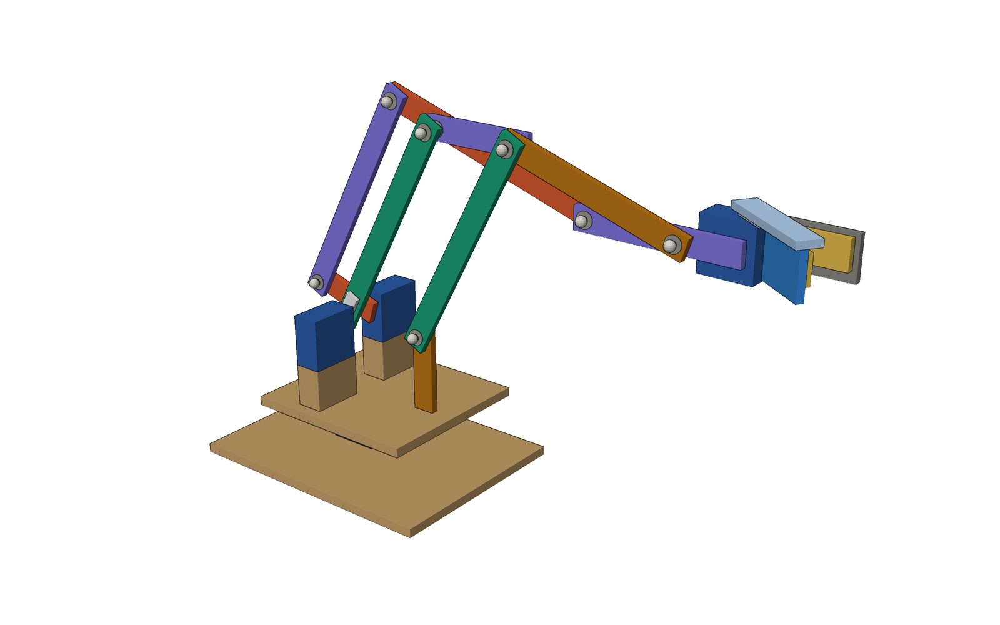
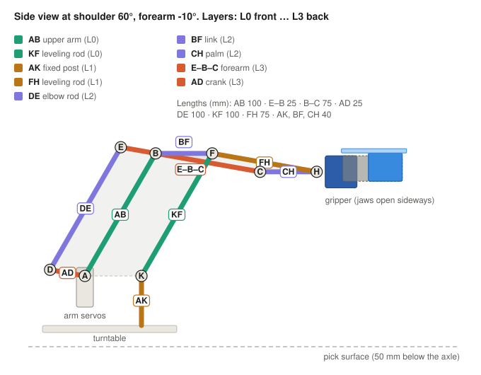
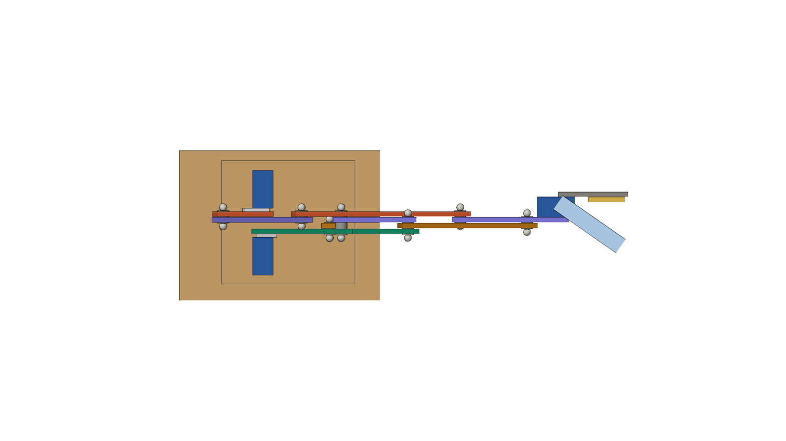
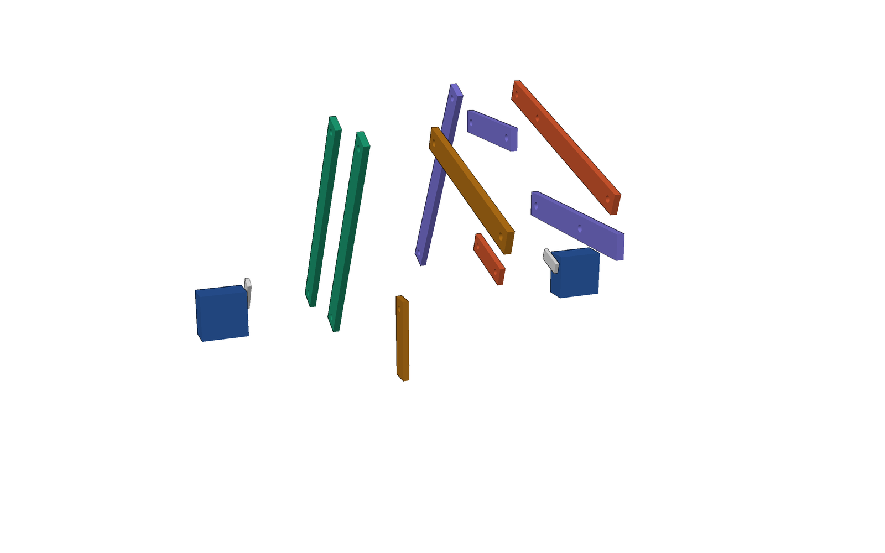
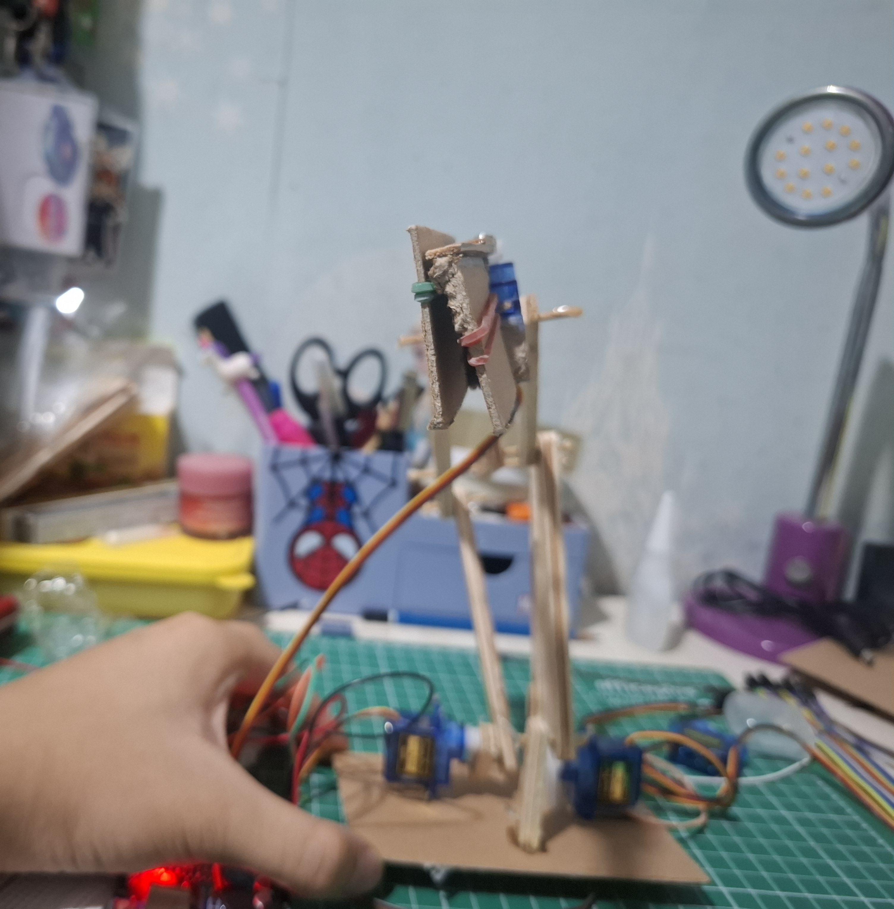
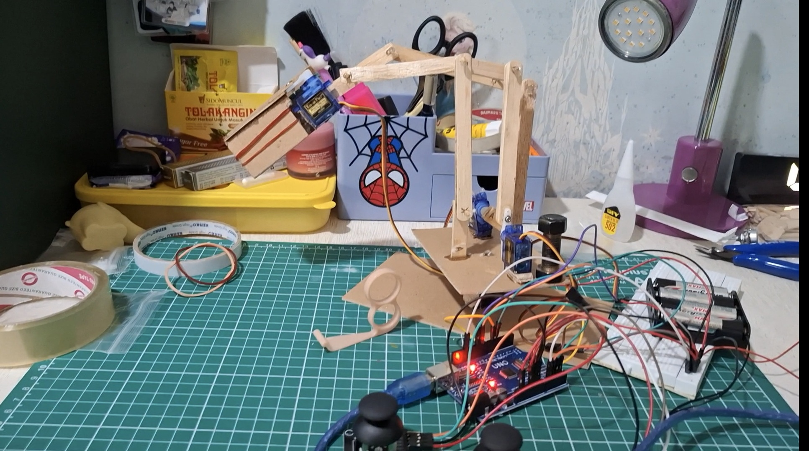
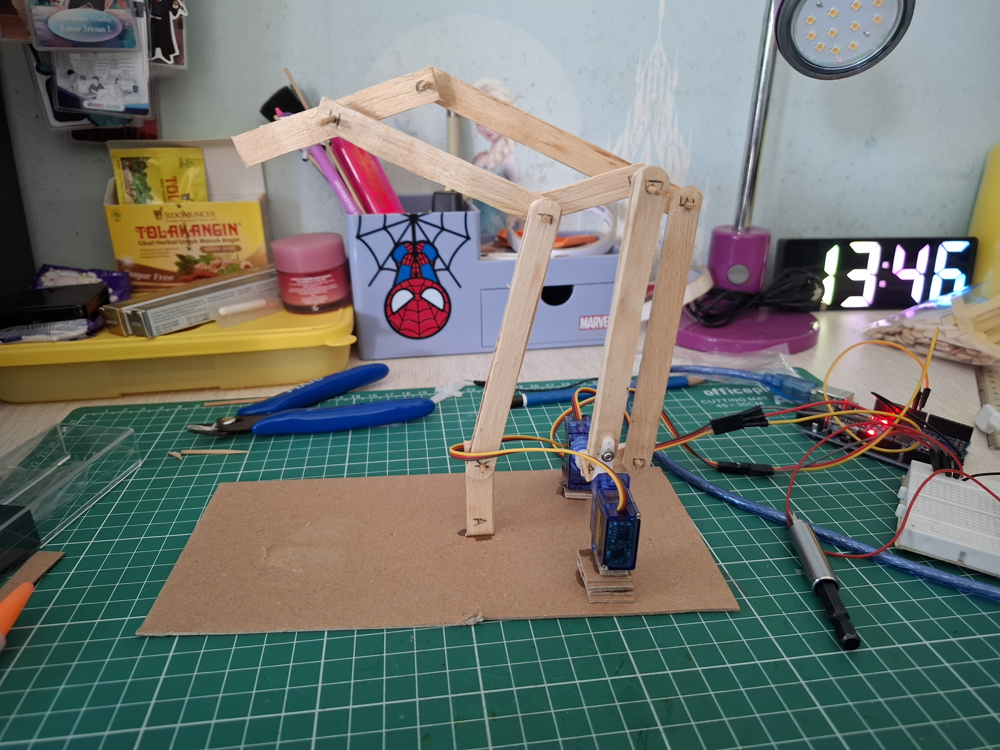
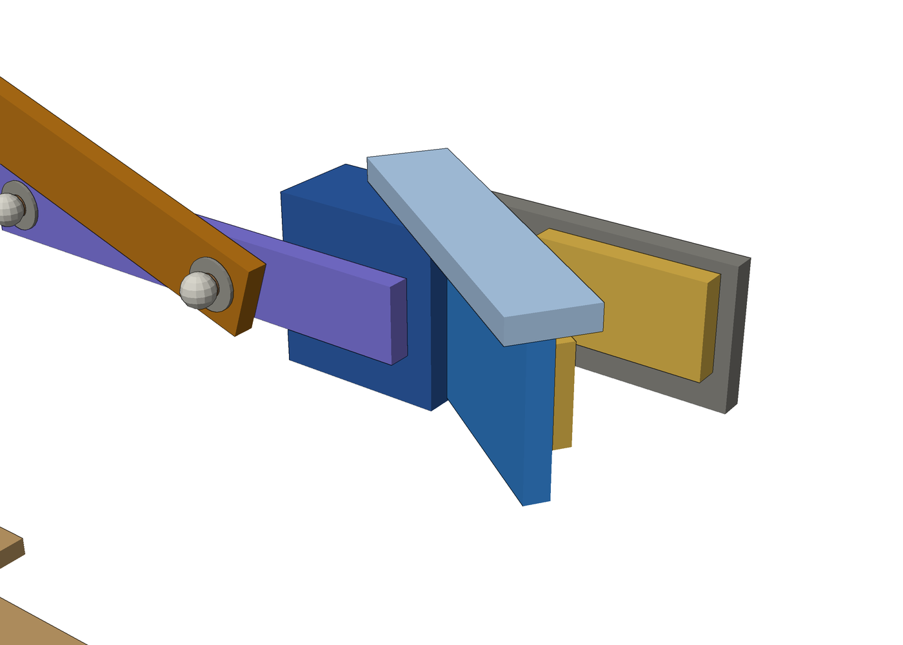

# Parallelogram-Linkage Robot Arm

This project is a simple 3-DOF gripper servo but made with a parallelogram linkage to minimize the load for the servos at the base. By using this design, we can keep the shoulder and elbow servo at the base of the arm. The project is made out of craft wooden sticks, bamboo pins/sticks for the joints, and 4 SG 90 Motors. You would also need a dedicated power supply (I used 4 AA Batteries, but NIMH rechargeable batteries or a dedicated 5V 2A power supply would probably be better), and an Arduino UNO or Nano



## Status

*ALL PARTS SHOULD BE WORKING*

## Main Features

- **Parallelogram linkage.** The upper arm AB and the forearm E–B–C are driven by two servos that both sit on the base. A crank, a rod and the forearm's rear extension form one parallelogram that copies the crank's angle onto the forearm. Two more parallelograms carry a fixed direction along the arm, so the palm never tilts.
- **Designed with numbers before cutting wood.** The linkage was simulated over its whole range of motion (2,031 poses). The simulation checks clearances between sticks, pin clearances, reach, gravity torque and sensitivity to length errors. See [analysis/linkage_check.py](analysis/linkage_check.py) and [analysis/results.txt](analysis/results.txt).
- **Very cheap and light.** Every link is three 10 × 110 × 1 mm craft sticks glued flat. Pivots are 3 mm bamboo skewers with hot-glue stops. The moving mass is about 29 g.
- **Four layers.** Nine links, eight pivots, four layers. An earlier layer layout failed the clearance check (the elbow rod hit a servo body at low shoulder angles), and the current one passes.
- **Smooth firmware.** Joystick readings are smoothed, a centre dead zone ignores spring bounce, small angle changes are ignored, and the servo speed is limited.

## Design at a glance



| Link | Pivot to pivot | Layer | Role |
|---|---|---|---|
| AB | 100 mm | L0 | Upper arm, driven by the shoulder servo |
| KF | 100 mm | L0 | Leveling rod |
| AK | K is 40 mm in front of the axle | L1 | Fixed post |
| FH | 75 mm | L1 | Leveling rod |
| DE | 100 mm | L2 | Elbow rod |
| BF | 40 mm | L2 | Leveling link |
| CH | 40 mm | L2 | Palm, always horizontal, carries the gripper |
| E–B–C | E–B 25 mm, B–C 75 mm | L3 | Forearm with a rear extension |
| AD | 25 mm | L3 | Crank, driven by the elbow servo |





Key numbers from the simulation (see [docs/DESIGN_NOTES.md](docs/DESIGN_NOTES.md)):

| Item | Value |
|---|---|
| Range of motion | Shoulder 45–120°, elbow 40-130°, angle between the links 20–150° |
| Tightest clearance on one layer | 2.5 mm between stick edges (elbow rod DE against link BF) |
| Reach of the palm end | 71–209 mm from the shoulder axle |
| Moving mass | About 29 g, gripper included |
| Worst-case gravity moment about the axle | 0.46 kg·cm empty, 0.71 kg·cm with a 10 g object |
| Effect of a 0.5 mm rod-length error | Palm or forearm tilts by about 1° typically, up to about 6° at the ends of travel |

## 3D model & Photos





The STL files are in [cad/stl](cad/stl). GitHub shows each one in an interactive 3D viewer: click a file and drag to rotate.

You can watch a demo video in the photos folder, where there is a youtube link

| File | Contents |
|---|---|
| [arm_assembly.stl](cad/stl/arm_assembly.stl) | The complete arm at one pose |
| [layer0_front.stl](cad/stl/layer0_front.stl), [layer1.stl](cad/stl/layer1.stl), [layer2.stl](cad/stl/layer2.stl), [layer3_back.stl](cad/stl/layer3_back.stl) | One layer of sticks each |
| [pins_washers_glue_stops.stl](cad/stl/pins_washers_glue_stops.stl) | Bamboo pins, washers and glue stops |
| [base_and_servos.stl](cad/stl/base_and_servos.stl) | Turntable, base board and the servos |
| [gripper.stl](cad/stl/gripper.stl) | The single moving jaw gripper, including the zip tie |

The model is generated by [cad/generate_cad.py](cad/generate_cad.py), so changing a parameter (link lengths, pose, jaw angle) and re-running the script updates the STL files and the renders.




## Bill of materials

| Item | Qty | Notes |
|---|---|---|
| Arduino Uno | 1 | A Nano also works |
| SG90 micro servo | 4 | Base, shoulder, elbow, gripper |
| Analog joystick module | 2 | VRx, VRy, SW, +5V, GND |
| 4 AA/NIMH Batteries or 5V 2A Power Supply | 1 | For the servos only |
| Electrolytic capacitor | 1 | 470–1000 µF, across the servo power rails |
| Breadboard, jumper wires, servo extension cables | 1 set | |
| Craft sticks, 10 × 110 × 1 mm | about 40 | Every link is three sticks glued flat |
| Bamboo skewers, 3 mm | about 20 | Pivot pins |
| Hot glue, wood glue, thick super glue | 1 each | |
| Rubber bands/Anything grippy, cardboard | | Jaw pads, mounting, mock-up |
| Base board | 1 | About 15 × 15 cm, plywood or thick cardboard |

## Wiring

| Component | Connects to |
|---|---|
| Base servo (not used yet) | D3 |
| Shoulder servo signal | D5 |
| Elbow servo signal | D6 |
| Gripper servo signal | D9 |
| All servos, red and brown wires | External 5 V supply (+ and GND) |
| External supply GND | Arduino GND (shared ground) |
| Joystick 1 VRx | A0 (shoulder) |
| Joystick 2 VRy | A3 (elbow) |
| Joystick 2 VRx | A2 (gripper, planned) |
| Joystick +5V and GND | Arduino 5V and GND, not the servo supply |

NEVER power the servos from the Arduino's 5 V pin: four SG90s can pull over 2 A together and will reset/short the board.

## Firmware

[firmware/arm_shoulder_elbow/arm_shoulder_elbow.ino](firmware/arm_shoulder_elbow/arm_shoulder_elbow.ino) maps stick position directly to servo angle:

| Control | Mapping |
|---|---|
| Joystick 1, X axis → shoulder | raw 1023 (left) = 45° (furthest front/left), raw 0 (right) = 120° (furthest back/right) |
| Joystick 1, Y axis → elbow | raw 0 (up) = 40° (furthest up), raw 1023 (down) = 130° (furthest down) |
| Joystick 2, X axis → base | raw 0 (open) = 0° (furthest left/right), raw 1023 (close) = 180° (furthest left/right)  |
| Joystick 2, Y axis → gripper | raw 0 (up) = 0° (furthest open), raw 1023 (down) = 180° (furthest closed) |

**MAKE SURE TO CALIBRATE IT AGAIN IN ACCORDANCE TO YOUR DESIGN, OR ELSE YOU RISK STRAINING AND DAMAGING YOUR MOTORS**

## Repository layout

```
cad/               generate_cad.py and the STL files
analysis/          linkage_check.py and its results
docs/              design notes, gripper design, scheme drawings, renders, photos
firmware/          Arduino sketches
```

Rebuild the model and renders: `pip install numpy pillow`, then `python3 cad/generate_cad.py`.
Re-run the checks: `python3 analysis/linkage_check.py`.

## What I learned


-A better power source than AA batteries would be ideal, since its electric current is limited.
- A dry fit needs a temporary axle at the shoulder, if not the arm would just drag along as nothing is acting as its pivot
- Simulating before actually building it allowed me to find collisions I wouldn't have noticed. 
- With 1 mm sticks, lamination (three sticks per link) is what makes the arm stiff enough sideways and avoiding sag that would make the arm more inacurate

## AI assistance

I used Claude to help generate the 3D schemes, as I am still learning on how to do so myself. I built, tested, and calibrated the arm on my own, and also made the firmware though I used AI to troubleshoot.

## License

MIT, see [LICENSE](LICENSE).
