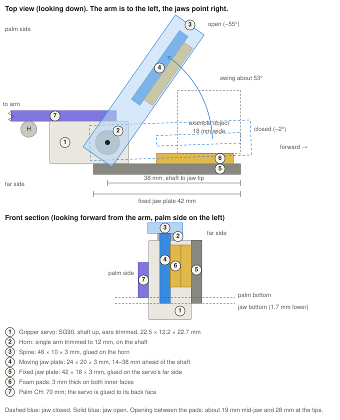

# Gripper design: single moving jaw

The fixed jaw is a plate glued face to face onto the palm CH. The servo is clamped against the far face of that plate with a zip tie, with its shaft pointing up. A flat spine rides on the horn, and the moving jaw plate hangs from the spine. The jaw swings sideways, away from the palm, and closes on an object against the fixed jaw.

**Why this layout.** When the gripper squeezes an object, the force on the fixed jaw goes through the plate straight into the palm, wood to wood over a glued area of about 260 mm². Nothing is glued to the servo's smooth plastic case, so the servo can be replaced in a minute. The squeeze also tries to pull the servo away from the plate, and the zip tie carries that load.

All distances are measured from the servo shaft unless they say pin H. The shaft is 22.5 mm in front of pin H, and forward is the direction the jaws point.

| Item | Value |
|---|---|
| Palm CH | 75 mm stick, three layers, holes for pins C and H |
| Fixed jaw plate | 56.5 × 18 × 3 mm, glued onto the palm's back face, starting 4 mm in front of pin H. About 26 mm of it overlaps the palm |
| Servo | SG90, shaft up, mounting ears trimmed off, 22.5 × 12.2 × 22.7 mm. Its palm-side face rests against the plate, its rear end is 6 mm in front of pin H, and it is centred vertically on the palm |
| Zip tie | Around the palm, the plate and the servo, 11 mm in front of pin H, behind the spine |
| Spine | 46 × 10 × 3 mm, from 5 mm behind the shaft to 41 mm in front |
| Moving jaw plate | 24 × 20 × 3 mm, from 14 mm to 38 mm in front of the shaft |
| Pads | 3 mm foam on both inner jaw faces |
| Jaw swing | About 53°: closed at +2°, open at +55°, away from the palm |
| Opening between the pads | About 19 mm mid-jaw and 28 mm at the tips |
| Largest object | About 18 mm wide and 10 g |
| Gripper weight | About 14 g |

## Parts

| Part | Made from | Notes |
|---|---|---|
| Gripper servo | SG90 | Cut both mounting ears off |
| Horn | Single-arm horn | Trim the arm to 12 mm from the centre |
| Spine | 3 sticks laminated, 46 mm | 3 mm hole 5 mm from the rear end for the horn screw |
| Moving jaw plate | 3 layers of two sticks side by side | 24 mm long, plus a 24 mm splint across the seam on the outer face |
| Fixed jaw plate | 3 layers, each a full stick plus one trimmed to 8 mm | 56.5 mm long, plus a splint across the seam on its outer face |
| Foam pads | Craft foam | 3 × 12 × 22 mm, two of them |
| Zip tie | Small, about 2.5 mm wide | One |

## Build steps

1. Make the jaw plates and the spine, and let the glue dry.
2. Centre the servo at 90° with the test sketch in [../firmware/gripper_servo_test](../firmware/gripper_servo_test/gripper_servo_test.ino).
3. Glue the fixed jaw plate flat onto the palm's back face with wood glue and clamp it with clothespins. Start it 4 mm in front of pin H, so it clears the glue ball. Its bottom edge is 6.65 mm below the palm's centre line and its top edge 11.35 mm above it. Let it dry.
4. Place the servo against the plate's far face, with its rear end 6 mm in front of pin H. Add only a few dabs of hot glue, then pull the zip tie snug around the palm, the plate and the servo, 11 mm in front of pin H, and trim it. Do not use super glue on the servo case.
5. With the servo at 90°, fit the horn so the jaw points about 28° away from the palm (half open), and fix it with the centre screw.
6. Glue the spine flat on the horn arm, with its hole over the centre screw. Glue the moving jaw plate under the spine, 14 mm to 38 mm in front of the shaft.
7. Glue a foam pad on each inner jaw face.
8. Use the test sketch to find the closed and open angles, and never go past them.

Checkpoints: the jaw swings from closed to open without touching the servo or the H pin, the pads meet evenly when closed, and the servo does not move when you push the jaw by hand.

## Changes from the first design

In the first design the fixed jaw was glued to the servo case and the moving jaw opened toward the palm. Now the fixed jaw is glued to the palm and the moving jaw opens away from it, which also means the palm's length no longer limits the jaw swing.
